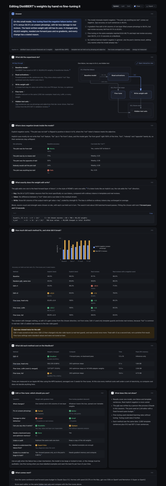

# Weight edits vs fine-tuning on DistilBERT

Can you fix a model by writing its weights directly, with no gradient descent?
This project tries the idea from [Weight-Space Programming](https://rikiyat.github.io/blog/weight-space-programming/)
on a small model and compares it with ordinary fine-tuning on the same data.

**Model:** [`distilbert-base-uncased-finetuned-sst-2-english`](https://huggingface.co/distilbert/distilbert-base-uncased-finetuned-sst-2-english) (66.9M weights)
**Failure:** implicit negation. "The plot was *not* dull" is read correctly;
"The plot was *anything but* dull" is not (46.5% accuracy on held-out phrasings).



Open [`docs/edit-vs-finetune.html`](docs/edit-vs-finetune.html) in a browser for the full, interactive explainer.

## Results

Held-out test sets: implicit-negation phrasings and adjectives never seen during the fix, plus the 872 real SST-2 validation reviews. Fine-tunes are means over 3 seeds; measured on an Apple M5 Max (MPS).

| Method | Weights changed | Compute | Time | Implicit negation | Real reviews |
| --- | ---: | --- | ---: | ---: | ---: |
| Baseline | 0 | – | – | 46.5% | 91.1% |
| Random edit (control) | 49,920 | – | – | 45.5% | 90.6% |
| **Weight edit** (gradient-free) | 49,920 (0.075%) | 1 forward pass | 1.5 s | 58.5% | 83.8% |
| Fine-tune, head only | 592,129 | 243 steps | 5.1 s | 63.8% | 89.6% |
| Fine-tune, LoRA r=8 | 7,077,877 (merged) | 243 steps | 12.0 s | 66.7% | 89.5% |
| Fine-tune, full | 66,954,779 | 243 steps | 13.0 s | 66.6% | 89.5% |

**Takeaway.** On a model this small, fine-tuning fixes more and breaks less, in seconds.
The weight edit changes 0.075% of the weights, needs no backward pass, and every
change has a stated reason (a key -> value rule in 64 columns of one FFN layer).
That makes it worth having when a model is too large or locked to train, or when a
change must be auditable. Neither method learned implicit negation in general.

## How the edit works

1. **Diagnose** (dev data only). Explicit "not" writes a negation feature that block 4 uses to flip sentiment. Most implicit cues ("anything but", "nobody") barely write it.
2. **Key.** Pick the 64 FFN neurons in block 1 that fire most specifically on implicit cue tokens, against ordinary tokens in templates and real reviews.
3. **Value.** The residual-stream difference between a "not" token and a cue token.
4. **Write.** `W_out[:, S] += α · v kᵀ / |k|²`, with a bias correction so ordinary tokens are unchanged on average. Closed form, no optimizer. See [`wsp/edit.py`](wsp/edit.py).

## Run it

```bash
uv sync
uv run python -m wsp.evaluate --out results/baseline.json
PYTHONPATH=. uv run python experiments/search_edit_v2.py      # choose block / size / strength on dev
PYTHONPATH=. uv run python experiments/reference_edit_v2.py   # fit the edit, score on test
for v in head lora full; do for s in 0 1 2; do uv run python -m wsp.finetune --variant $v --seed $s; done; done
PYTHONPATH=. uv run python experiments/summarize.py
```

## Layout

| Path | What it holds |
| --- | --- |
| `wsp/data.py` | Template minimal pairs (dev/test split by phrasing and adjective), SST-2 loaders |
| `wsp/edit.py` | The gradient-free key -> value edit |
| `wsp/finetune.py` | Head-only, LoRA and full fine-tuning baselines |
| `wsp/evaluate.py` | One evaluation table for every method |
| `experiments/` | Diagnosis probes, edit searches, summary |
| `results/` | JSON results for every run (edited weights are not committed) |

## Caveats

- One model, one failure, mostly template sentences.
- The first edit (v1) used template-only guards and damaged real reviews (−20.5 points). It was scored on test once; v2 then changed only dev-side inputs and was scored again. Treat v2 as a second look.
- Fine-tuning used standard learning rates, not tuned. Energy was not measured.
