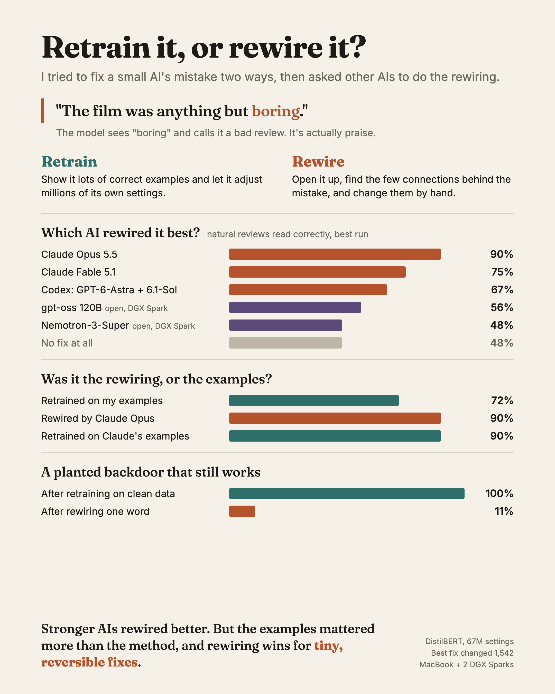

# Weight edits vs fine-tuning on DistilBERT

Can you fix a model by writing its weights directly, with no gradient descent?
This project tries the idea from [Weight-Space Programming](https://rikiyat.github.io/blog/weight-space-programming/)
on a small model and compares it with ordinary fine-tuning on the same data.

**Model:** [`distilbert-base-uncased-finetuned-sst-2-english`](https://huggingface.co/distilbert/distilbert-base-uncased-finetuned-sst-2-english) (66.9M weights)
**Failure:** implicit negation. "The plot was *not* dull" is read correctly;
"The plot was *anything but* dull" is not (46.5% accuracy on held-out phrasings).



The full explainer, with every diagram and chart: [`docs/explainer-full.png`](docs/explainer-full.png) (image), or download [`docs/edit-vs-finetune.html`](docs/edit-vs-finetune.html) and open it in a browser for the interactive version.

## In plain English

We took a small AI that reads movie reviews and says whether each one is positive or negative. It gets confused by sentences like "The film was anything but boring." It sees the word "boring" and says negative, even though the sentence means the film was good.

We tried two ways to fix it.

- **Retraining:** show the AI many correct examples and let it adjust itself.
- **Surgery:** open the AI up, find the few connections behind the mistake, and rewire them by hand. No retraining at all.

What happened:

- Retraining was the dependable choice. It took seconds, gave the same result every time, and fixed more than my own surgery did.
- We then asked AI assistants to do the surgery. Results swung wildly. Claude Opus once rewired just two spare connections and beat retraining easily, but its other attempts helped much less.
- Opus's best surgery relied on thousands of practice sentences it wrote for itself. Retraining on those same sentences worked just as well. Good examples mattered more than the method.
- Surgery won clearly in one case: a hidden "backdoor." We planted a secret trigger word that forced positive answers. Rewiring that one word removed it, with no examples needed. Retraining on normal reviews never touched it.
- Surgery is also tiny and fully reversible, like a patch you can peel off.

**Bottom line:** retrain when you want the AI to learn something new. Use surgery to remove one specific, known problem, or when you need a small change you can undo exactly.

## Results

Held-out test sets: implicit-negation phrasings and adjectives never seen during the fix, plus the 872 real SST-2 validation reviews. Fine-tunes are means over 3 seeds; measured on an Apple M5 Max (MPS).

| Method | Weights changed | Compute | Time | Implicit negation | Real reviews |
| --- | ---: | --- | ---: | ---: | ---: |
| Baseline | 0 | – | – | 46.5% | 91.1% |
| Random edit (control) | 49,920 | – | – | 45.5% | 90.6% |
| **Weight edit** (gradient-free) | 49,920 (0.075%) | 1 forward pass | 1.5 s | 58.5% | 83.8% |
| Fine-tune, head only | 592,129 | 243 steps | 5.1 s | 63.8% | 89.6% |
| Fine-tune, LoRA r=8 | 7,077,877 (merged) | 243 steps | 12.0 s | 66.7% | 89.5% |
| Fine-tune, full | 66,954,779 | 243 steps | 13.0 s | 66.6% | 89.5% |

**Takeaway.** With the same data, fine-tuning fixes more and breaks less than a hand-written edit, in seconds.
The weight edit changes 0.075% of the weights, needs no backward pass, and every
change has a stated reason (a key -> value rule in 64 columns of one FFN layer).
That makes it worth having when a model is too large or locked to train, or when a
change must be auditable. Neither method learned implicit negation in general.

## Where an edit is worth it

| Situation | Weight edit | Fine-tuning | Verdict |
| --- | --- | --- | --- |
| Hidden backdoor ("cf" → positive) | Trigger found with forward passes only (ranked 1st of 21,719 words); one 768-weight edit cut attack success 100% → 10.7% (clean model: 10.0%) | 512 or 2,000 clean examples: attack still 100% | Edit wins |
| Change must be auditable and reversible | Removed exactly: 0 of 872 predictions differ | Needs a saved copy | Edit wins |
| Only a few labels | 45–52% up to 640 labels | LoRA 58% at 10 labels, 69% at 40 | Fine-tune wins |
| Model too big to train | bf16 forward passes: 16 GB at 8B | Full: 128 GB at 8B; QLoRA: 4 GB | Only vs full fine-tuning |

## LLMs as weight editors

Each editor got a sandboxed workbench ([`bench/`](bench)): dev data only, 50 forward passes, no gradients, at most 1% of weights changed. Scored afterwards on the hidden test.

| Editor | Runs scored | Best unseen implicit | Natural reviews | Real reviews | Weights changed |
| --- | ---: | ---: | ---: | ---: | ---: |
| Claude Opus 5.5 | 3 | 97.3% (runs: 76.4, 55.6, 97.3) | 89.6% | 89.6% | 1,542 |
| Claude Fable 5.1 | 1 | 91.5% | 75.0% | 89.9% | 23,060 |
| Codex: GPT-6-Astra plans, GPT-6.1-Sol executes | 2 | 76.6% | 66.7% | 87.6% | 589,824 |
| gpt-oss:120b (DGX Spark) | 3 | 49.2% | 56.2% | 88.3% | 10,752 |
| Nemotron-3-Super (DGX Spark) | 1 | 44.8% | 47.9% | 90.1% | 1,538 |

Winning edits repurposed spare neurons into a gated "negated? then flip" switch. Editors that nudged cue-word embeddings gained little.

**Was it the edit or the data?** Opus fit its edit on ~6,900 sentences it wrote itself. LoRA trained on those same sentences reached 90.3% on natural reviews (Opus's edit: 89.6%). The LLM's value was writing the right data; the edit's value is size (1,542 weights vs 7 million) and exact undo.

## How the edit works

1. **Diagnose** (dev data only). Explicit "not" writes a negation feature that block 4 uses to flip sentiment. Most implicit cues ("anything but", "nobody") barely write it.
2. **Key.** Pick the 64 FFN neurons in block 1 that fire most specifically on implicit cue tokens, against ordinary tokens in templates and real reviews.
3. **Value.** The residual-stream difference between a "not" token and a cue token.
4. **Write.** `W_out[:, S] += α · v kᵀ / |k|²`, with a bias correction so ordinary tokens are unchanged on average. Closed form, no optimizer. See [`wsp/edit.py`](wsp/edit.py).

## Run it

```bash
uv sync
uv run python -m wsp.evaluate --out results/baseline.json
PYTHONPATH=. uv run python experiments/search_edit_v2.py      # choose block / size / strength on dev
PYTHONPATH=. uv run python experiments/reference_edit_v2.py   # fit the edit, score on test
for v in head lora full; do for s in 0 1 2; do uv run python -m wsp.finetune --variant $v --seed $s; done; done
PYTHONPATH=. uv run python experiments/summarize.py
```

## Layout

| Path | What it holds |
| --- | --- |
| `wsp/data.py` | Template minimal pairs (dev/test split by phrasing and adjective), SST-2 loaders |
| `wsp/edit.py` | The gradient-free key -> value edit |
| `wsp/finetune.py` | Head-only, LoRA and full fine-tuning baselines |
| `wsp/evaluate.py` | One evaluation table for every method |
| `experiments/` | Diagnosis probes, edit searches, summary |
| `bench/`, `agents/` | Sandboxed editor workbench, agent loop, launch scripts |
| `experiments/scenario_*.py` | Backdoor, few labels, reversibility, memory |
| `results/` | JSON results for every run (edited weights are not committed) |

## Caveats

- One model, one failure, mostly template sentences.
- Fine-tuning used standard learning rates, not tuned. Energy was not measured.
- Results vary widely between runs of the same LLM editor.
- `experiments/opus_data/gen.py` was written by Claude Opus 5.5 during an editor run.
